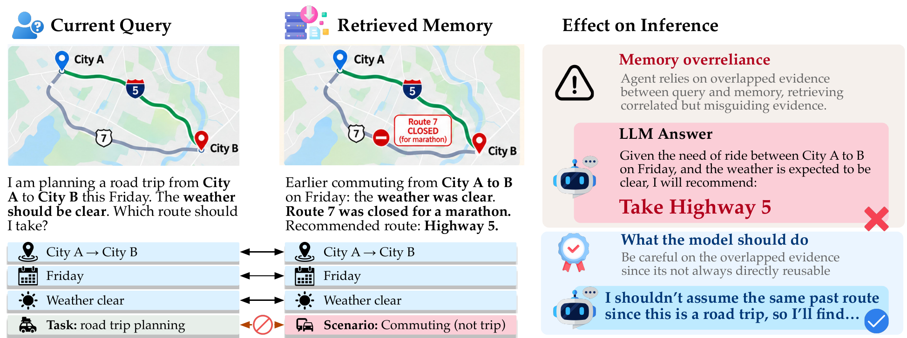
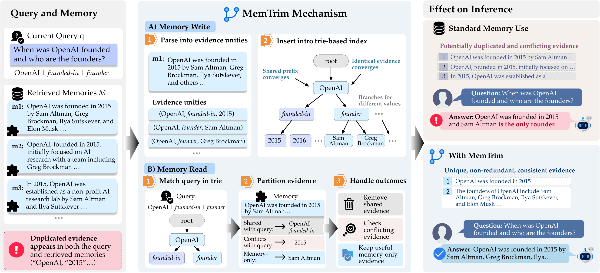

# MEMTRIM

<p align="center">
  <b>Understanding and Mitigating Inference-Time Overreliance Using Agentic Memory</b>
</p>

<p align="center">
  
</p>

A retrieved memory can be benign, correctly stored and correctly retrieved, yet
still mislead the model when only part of its evidence transfers to the current
query (**memory overreliance**). MEMTRIM is a plug-and-play layer around an
existing memory system: it indexes each stored interaction as canonical
evidence units in a trie at write time, and at read time removes evidence the
query already states, drops evidence that conflicts with the query, keeps
memory-only evidence, and suppresses / relabels the stored answer when its
support changed or the task changed (Eq. 1).

<p align="center">
  
</p>

---

## Installation

```bash
python -m venv .venv && source .venv/bin/activate
pip install -r requirements.txt
```

Servers you need for the full runs:

| What | How |
|---|---|
| Open-weight backbone | `vllm serve <checkpoint> --port 8000 --served-model-name qwen` (set `llm.model` / `base_url` in `configs/main_qwen.yaml`) |
| API backbone | `export OPENAI_API_KEY=...` (set `llm.model` in `configs/main_gpt.yaml`) |
| MemGPT | `pip install letta && letta server` (port 8283) |
| Graphiti | nothing (embedded Kuzu); or set `memory.graphiti.uri` for Neo4j |

## Quick check (offline, ~1 s)

```bash
python -m unittest discover -s tests            # 24 tests: trie, Eq. 1, ablations, parser, case studies, stats
python -m memtrim.data.build --encoder hash --out-dir data/processed_smoke   # needs data/raw, see below
python scripts/run.py --config configs/smoke.yaml && python -m memtrim.report results/smoke
```

`configs/smoke.yaml` uses a mock LLM and a local dense store; it checks that
every stage runs, and its numbers mean nothing.

## Reproducing the paper

```bash
bash scripts/download_data.sh                   # RippleEdits, CLADDER, CounterLogic at pinned commits
python -m memtrim.data.build --dataset all      # Appendix C -> data/processed/*.jsonl (+ balance report, C.4)
bash scripts/run_all.sh                         # everything below, resumable
```

Before a full run, try any config with `--limit 5` to confirm your servers work.

| Paper | Command | Output |
|---|---|---|
| Table 1 (RQ1) | `scripts/run.py --config configs/main_{qwen,gpt}.yaml` → `memtrim.report` | rows `No Mem.` / backbone in `results/<run>/tables.md` |
| Table 2 (Mem0) / Tables 3–4 | same runs (all baselines × 4 backbones) | `tables.md`, `tables.tex`, `summary.csv` |
| Fig. 2 / Fig. 8 (RQ2) | `python -m memtrim.experiments.rq2 results/<run>` | `fig_rq2_<dataset>.pdf`, `rq2_<dataset>.json` |
| Fig. 3 / Fig. 9 (RQ3) | `python -m memtrim.experiments.rq3 --config configs/rq3.yaml` | `fig_rq3_<dataset>.pdf`, `rq3_report.json` |
| Fig. 5 (ablations) | `scripts/run.py --config configs/ablation_qwen.yaml` → `report --ablation` | `fig5_ablation.pdf` |
| Fig. 6 (attacks) | `python -m memtrim.experiments.attack --config configs/attack.yaml` | `fig6_attack.pdf` |
| Fig. 7 (runtime) | `scripts/run.py --config configs/runtime_qwen.yaml` → `report --runtime` | `fig7_runtime.pdf` |
| App. B.4 case studies | `tests/test_method.py::CaseStudies`, `Eq1Tests` | – |

All LLM calls are cached on disk (`.cache/llm`), so re-running a config
reproduces the same outputs without re-querying; the runtime config bypasses
the cache.

## Code map

```text
memtrim/
  schema.py      EvidenceUnit, MemoryRecord m=(E_m, tau_m, H_m, o_m), MemTrimOptions (ablation switches)
  trie.py        trie index: key path (entity|attribute|type) -> value leaf -> {memory_id: in_support}
  core.py        write-time indexing; read-time partition S/D/U, Eq. 1, multi-memory merge, rendering
  parser.py      LLM parser: typed units, span grounding, validation + 1 retry, key/task/value canonicalisation
  llm.py         OpenAI-compatible client (vLLM or OpenAI), deterministic decoding, sqlite cache; mock backend
  memory/        adapters: Mem0, A-Mem, MemGPT (Letta), Graphiti; local dense store for tests
  methods.py     no-memory, backbone, 9 baselines, MEMTRIM + 5 ablations, 3 attack defenses
  data/build.py  Appendix C pair construction (no LLM involved)
  runner.py      stores, retrieval, all methods on the same retrieved items, resumable JSONL output
  report.py      Tables 1-4, Fig. 5, Fig. 7
  stats.py       Simonsohn two-lines test, quadratic test, RQ2 overlap tests
  experiments/   rq2.py, rq3.py, attack.py
```

